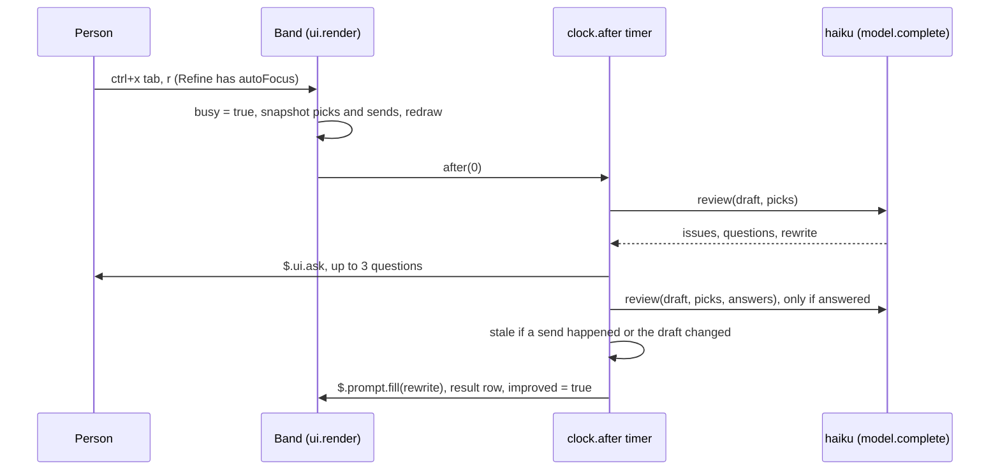

# Refine band pickers and the Refine button

## At a glance

| Commits | Files | Tests added | Decisions | Open items |
| --- | --- | --- | --- | --- |
| 3 on `claude/happy-murdock-e37ada` | 6 | 25 (66 to 91) | 9 | 4 |

Phase 1 of `docs/proposals/refine-band.md` is in [PR 21](https://github.com/shawn-sandy/prompt-triage/pull/21): the
`AbovePrompt` band now draws Goal, Workflow and Scope `Select`s and a Refine `Button` beside the existing desktop-only
Run in picker, wired to the existing `review()` through a new `reviewer(picks)` system-prompt builder. `claude plugin test .`
passes 91 of 91 and `tsc --noEmit` exits 0. Live terminal runs found three bugs the test kit cannot see (the press budget,
picker order, spacing); all are fixed. The desktop app's native layout is unverified, and nothing is merged.

## Architecture and code paths

Everything lives in `hooks/register.ts`. Read in this order:

1. **`PICKERS`** (L38): one table per picker, `value -> [label, reviewer line]`. The first option is the default and its
   line is `''`. Object order (workflow, goal, scope) is the order the reviewer reads the lines in;
   **`PICKER_KEYS`** (L83) is the separate draw order (goal, workflow, scope).
2. **`reviewer(picks)`** (L98): `REVIEWER` plus `- <line>` for each non-default pick. All defaults return `REVIEWER`
   byte for byte, so the dialog path and `/refine-prompt` are unchanged unless a pick is set.
3. **`shows(draft, band)`** (L104): the show rule. Trimmed draft non-empty, not `/`-prefixed, and `band === 'always'`
   or trimmed length >= 40 or the *untrimmed* draft has `\n`.
4. **`review()` / `rework()` / `improve()`** (L156, L215, L224): `review` takes `picks` now; `rework` is the old
   review-interview-review middle of `improve`, split out so the band can check the draft before filling.
5. **`refineDraft($, picks, wasSent)`** (L236): read draft, `rework`, then return `'stale'` if `wasSent()` or the draft
   changed, else `$.prompt.fill`. Returns `{ original, issues } | 'stale' | 'empty' | undefined`.
6. **The `ui.render` hook on `AbovePrompt`** (L339): yields to `hasSurvey`; loads picks once; draws, on terminal and
   desktop, either the picker row (`Refine` label, three Selects, Run in on desktop, Refine) or the result row
   (count, Show issues, Restore original, Done, Plan-first note, Run in). Run in alone when the rule fails on desktop.
7. **Refine's `onPress`**: sets `busy`, snapshots `picks` and `sends`, and starts the work with
   **`$.clock.after(0, ...)`** (L391), never inside the press.
8. **`prompt.edit` / `prompt.change`** (L456, L464): recompute `shows()` and `$.ui.invalidate('ui.render')` only when the
   answer flips.
9. **`prompt.submit`** (L483): `sends++` and clears `result` before anything else; the Run in and first-prompt logic
   below is untouched.

Module state in `register` (L327-L335): `picks: Promise<Picks>` (memoized load), `sends`, `shown`, `busy`, `result`.

Caption: the review runs on the timer, outside the press dispatch; the stale check sits between the last review and the fill.

## Cost of the band in a session

While typing, the band makes **no model calls**. Each keystroke runs the `prompt.edit` hook, which calls `shows()` locally
and redraws only when the answer flips. `$.store` is read once per session (the memoized `loadPicks`) and written once
per pick change.

Each Refine press makes **one** `haiku` call, and a **second** when the person answers at least one question. The same
holds for the model dialog's Refine prompt and `/refine-prompt`. Reply cap: `max(4096, ceil(draft.length / 2))`, at most
64,000; timeout 30 s per call.

Measured on 2026-11-07 with a scratch mod that made the exact `review()` call (`model: 'haiku'`, the same
`reviewer(picks)` system prompt, prompt wrapper, `maxTokens` and timeout), one live call per row (n = 1, so treat the
output column as indicative: output varies run to run):

| Case | System prompt (chars) | Input tokens | Output tokens |
| --- | --- | --- | --- |
| 58-char draft, default picks | 823 | 316 | 157 |
| 58-char draft, Add a check + Plan first + Minimal | 1,314 | 471 | 577 |
| Second review after one answer, default picks | 823 | 349 | 237 |
| 825-char draft, default picks | 823 | 543 | 1,681 |
| 825-char draft, Add a check + Plan first + Minimal | 1,314 | 698 | 2,043 |

What drives it: three non-default picks added 155 input tokens to the same draft, and output grows with the draft, since
the reply carries a full rewrite. A Refine with one answered question on the short draft cost 316 + 349 = 665 input and
157 + 237 = 394 output tokens across its two calls. No call hit the prompt cache (`cache_read_input_tokens` 0 throughout).

Billing: the calls go through `$.model.complete`, billed to the session's credentials. Per the mod reference, a
completion stays out of the session's own cost total and token metrics, so `/cost` will not show them; count them from
`usage` if needed. The main conversation's context is untouched: nothing from a refine reaches the model until the
person sends the prompt. A dollar figure is not given here: it needs Haiku's current per-token price, which was not
looked up in this session.

## Decisions

- **Pickers join the existing Run in hook**, not a second `AbovePrompt` hook. The band is one instance; a second hook
  of the same mod would draw over or hide the first.
- **Run in keeps its own rule**: desktop only, one-shot, drawn even when the phase 1 rule hides the rest, and unaffected
  by `band: never` (that setting governs the refine paths). A prompt with `turnId` still returns `next(e)` before the
  hand-off branch, so an armed pick stays armed, as PR 20 documents.
- **The show rule is computed in the render hook from `$.prompt.read()`**, with the edit/change hooks only invalidating
  on a flip. The test kit cannot raise `prompt.edit` or `prompt.change`, so a rule that lived only in those hooks would be
  untestable.
- **Each pick is one appended reviewer line**, defaults add nothing. Workflow first, then Goal, then Scope, per the
  proposal's conflict order. Draw order is separate (Goal, Workflow, Scope), from the proposal's layout.
- **Picks persist in `$.store` under `picks`**, validated on load (an unknown value falls back to the default). The model
  dialog's Refine prompt and `/refine-prompt` read the same picks, per the proposal's phase 1 line and its open question
  (flags were not added).
- **Refine runs from `$.clock.after(0)`.** A press dispatch has a 10 s budget; live, the old in-handler version was
  skipped with `ui.press hook skipped: ran past its 10s budget` and never filled the box. The mod reference names timers
  as the home for work that outlives a dispatch.
- **Stale guard: `sends` counter plus text equality.** Text alone missed a send during the review while the model dialog
  held the prompt (the box still held the same text). From the fresh-context review.
- **`autoFocus` on Refine.** ctrl+x tab put the ring on the Goal Select, whose list opened and ate `r`; Esc left the band.
- **Line-break check on the untrimmed draft.** Codex review (resolved thread): `Fix the typo` + Shift+Enter stayed hidden
  because `trim()` ran first. Reproduced with a failing case, then fixed; the prototype already checked untrimmed.

## Tradeoffs and rejected options

- **Module variables, not `$.state`, for band state.** The mod reference prefers `$.state` (it survives a hot reload). The
  file already keeps `handOff`, `improved` and the effort state in module variables, so the band matches. Cost: a reload
  drops an open result row and resets `busy`. Revisit if reloads in long sessions lose a result row someone wanted.
- **Toast and drop the rewrite when `$.prompt.fill` answers `isFilled: false`** (marked `ponytail:`). The band only draws
  where a box exists, so this should not happen. Upgrade path: append the rewrite as a `system` notice, as the proposal's
  Dialog path section suggests.
- **No always-on checks, no Dialog path changes.** Read as outside phase 1 ("using today's `review()`"). They are listed
  in the proposal's status line as not implemented.
- **Wrap instead of the proposal's one-row fallback.** At 80 columns the default picks fit one row
  (`Refine Goal: Auto ▾ Workflow: As written ▾ Scope: As written ▾ [ Refine ]`); longer picks wrap to a second row via
  `flexWrap`. The proposal's fallback (Refine only, pickers in one `$.ui.ask` multi-select) was not taken.

## Learnings

- **The test kit does not enforce the press budget.** Every kit test passed with the review running inside `onPress`;
  only a live session showed the 10 s skip. Long work from a handler needs a live run, not just `claude plugin test`.
- **A focused terminal `Select` draws its option list open** and takes letter keys. A band hotkey on a later Button is
  unreachable unless focus starts there.
- **`Text` takes no `key`.** `find({ key })` on a keyed `Text` returns undefined; key the enclosing `Box` instead.
- **The kit has no `$.store` on the test engine** (`$.store.get` is undefined in a test body); answer `store.get` /
  `store.set` with your own hooks to read what was saved.
- **`test(...)` cannot call `engine(on)` twice**: hooks beneath the plugin must be registered before the test's first
  `$` call. Loop at file level instead.
- **Live-testing gotchas:** sessions started in a pty register with Remote Control and appear on the person's other
  devices; one received a question from the person. A stray Enter after a refine sends the rewrite and starts a real
  turn. Driving `claude --plugin-dir` through Python `pty` plus `pyte` (no tmux on this machine) worked for reading the
  band at a fixed size.
- **Abandoned:** opening the prototype through `file://` in the browser pane (it renders a static snapshot with storage
  disabled); served it over `http://127.0.0.1` instead.

## Tests and verification

- 25 new tests in `hooks/register.test.ts` (66 to 91), each written to fail first: show rule table (incl. trailing `\n`),
  `band: always` / `never`, survey and `isWorking`, desktop Run in alone, pick persistence and invalid stored values,
  every pick changes the reviewer and defaults add none, Refine fill and result row, Show issues / Restore / Done, Plan-first
  note, questions, stale draft, failed and thrown reviews, first prompt marked refined, result row outlasting a short
  draft until send, double press, dialog and `/refine-prompt` use the picks, send during review, picks snapshot, draw
  order, Refine runs from a timer (confirmed failing against the in-handler code), Refine `autoFocus`.
- Test harness: `engine()` gained `draft`, `store` and `onReview`, and `mock.clock(on)`; `refine(ui)` presses then
  `settle()`s the timer.
- `npx -p typescript@5.9 tsc --noEmit -p .` exits 0 with `.claude-plugin/types` laid from the 2.1.317 skill types
  (gitignored).
- Live, 80x30 terminal: show rule, one-row fit at 80 and wrap at 60, picking with arrows, Refine via ctrl+x tab + `r`,
  question dialog, rewrite in the box, result row, Restore original. Show issues expanding was not seen live (the tall
  rewrite pushed it off the captured lines).
- Prototype walked in the browser pane: Run in alone on a short draft, Plan first + Refine result row, Show issues, Done;
  no console errors.
- **Knowingly untested:** the desktop app's native layout of the Selects and result row; the edit/change redraw-on-flip
  (the kit cannot raise those events); the overlapping-first-render picks race (fixed by memoizing, no test).

## Review follow-ups and tech debt

- **Desktop visual check** of the band (pickers, wrap, result row) is open.
- **Show issues live** in the terminal is unconfirmed.
- `ponytail:` in `refineDraft`: a refused fill loses the rewrite with a toast; upgrade to a `system` notice.
- Band state in module variables does not survive a reload (see Tradeoffs).
- Review threads: 1 of 1 resolved (the Codex line-break finding). CodeRabbit hit its review limit and did not review; the
  Claude review found no issues.

## Files touched

- **Mod code**
  - `hooks/register.ts`: `PICKERS`, `reviewer`, `shows`, `loadPicks`, `rework`, `refineDraft`; band render, Refine on a
    timer, result row; `prompt.edit` / `prompt.change` hooks; `sends` and result clearing in `prompt.submit`.
  - `.claude-plugin/plugin.json`: `userConfig.band` (`always` / `long` / `never`, default `long`).
- **Tests**
  - `hooks/register.test.ts`: harness additions and the 25 band tests.
- **Docs**
  - `README.md`: The refine band section, nine-hook table, cost and data lines.
  - `docs/proposals/refine-band.md`: status line says phase 1 and Run in are implemented.
  - `docs/prototypes/refine-prompt-band.html`: Run in alone when hidden and in the result row, Shift+Tab note in the
    row, no hint row, shipped-vs-proposal note, trimmed length rule.
